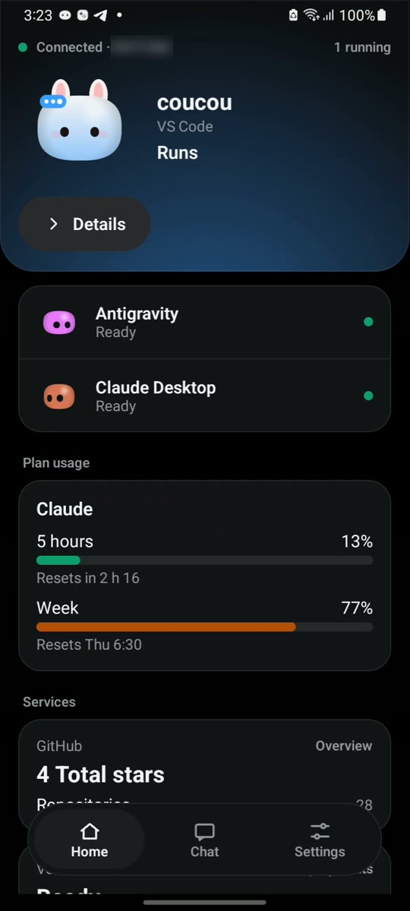
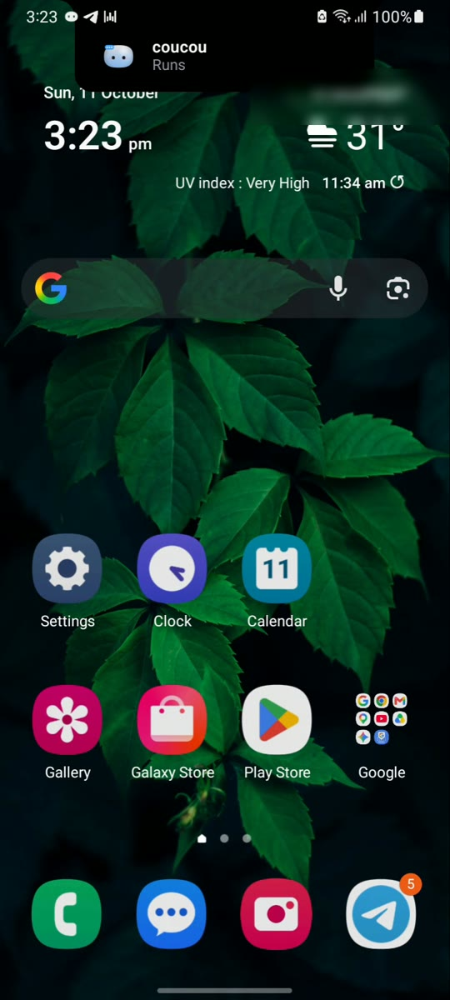
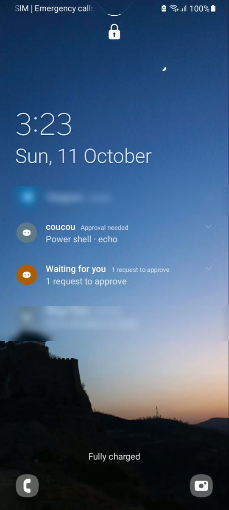
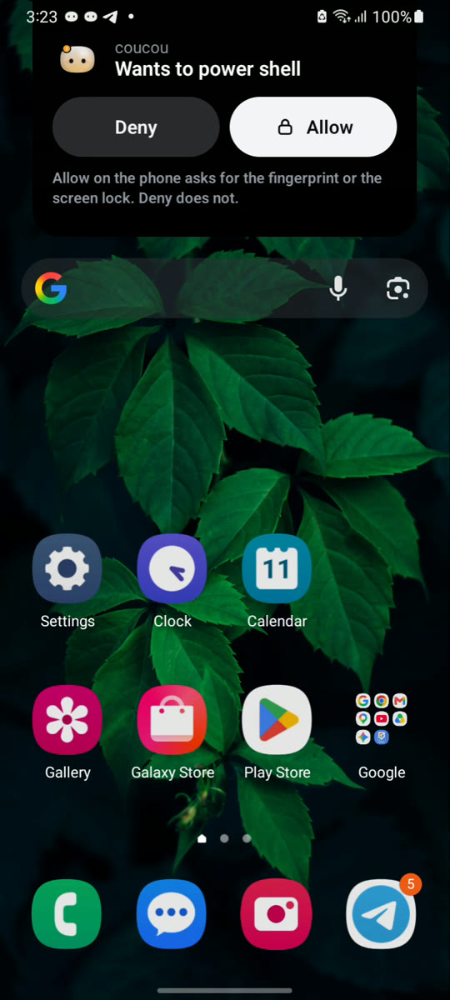

# Coucou for Android

The Android app of [Coucou](https://github.com/Louis-CFM/coucou) by Louis Raillé, by Rhytam Biswas. It shows your coding
agents as Mochi on your phone and lets you approve or deny their permission requests, answer their questions and chat
through your computer's AI providers.

The name, the Mochi character, the icon and the sounds are © Louis Raillé and used with permission (see
[PERMISSION.md](PERMISSION.md)). The Android code is © Rhytam Biswas under the MIT License (see [LICENSE](LICENSE)). The app is free: no ads, no billing, no analytics.
It speaks English, French, Spanish, Brazilian Portuguese, Simplified Chinese, Hindi, Bengali, Russian, Indonesian and Arabic (Settings > Language, or Android 13's own per-app language screen); the look is dark or light (Settings > Theme). Download the signed APK from the [Releases](https://github.com/Louis-CFM/coucou/releases/tag/android-v0.3.0) (Android 11 or later; it needs Coucou 0.4.0 or later on Windows or Linux).

## Screenshots

Real screenshots from a Galaxy A12s. The pairing, chat and approval screens are protected on purpose (Android shows them black in a screenshot), so they are not shown here. Other apps’ notifications and the location are blurred.

| Home | The island over other apps | Alert on a locked phone | Allow or Deny |
|---|---|---|---|
|  |  |  |  |

## Build and test

Needs JDK 17 and the Android SDK (platform 35). From this folder:

```bash
./gradlew test assembleDebug lint
node scripts/gen-strings.mjs --check      # res/values/strings.xml is generated from i18n/app-strings.json
```

A release build (R8 shrinking and obfuscation, resources shrunk, `android.util.Log` calls removed, not debuggable) is `./gradlew assembleRelease`;
`lint` already depends on it in CI, with a check that no debug log text is left in the APK. Signing keys are never in the repository: set
`COUCOU_KEYSTORE_FILE`, `COUCOU_KEYSTORE_PASSWORD`, `COUCOU_KEY_ALIAS` (and `COUCOU_KEY_PASSWORD` if it differs) in the environment or in
`~/.gradle/gradle.properties`. Without them the release APK is unsigned (it cannot be installed), never signed with a debug key. Keep
`app/build/outputs/mapping/release/mapping.txt` with the build you ship. Nothing is published from here.

Without a computer: open the app and tap *Try the demo*. Or run the pretend computer (fake sessions, a fake approval; a test tool):

```bash
node tools/dev-desktop.mjs --host <LAN IP>     # prints a pairing link; flags: --details --answers --diffs --usage --services --fake-chat
```

The desktop side is in `windows/src-tauri/src/phone_link`; the protocol is `docs/ANDROID_LINK.md`, the internet relay
`docs/RELAY_LINK.md` (deploy and test it with `docs/RELAY_DEPLOY.md`).

## What it does

- **Home**: the focused agent as a black hero panel (Mochi in the agent's colour, a plain sentence), the other agents below, plan
  usage and service cards when the computer offers them, and *Recent* (your own Allow/Deny decisions, kept only on the phone).
  Raw tool names become plain words (`core/ToolLabels.kt`); a command or path is never shown without a deliberate tap (`core/SafeText.kt`).
- **Languages** (Settings > Display > Language, or Android 13 and later: Android's own Apps > Coucou > Language): the phone's own, English, French (informal "tu", like the rest of Coucou), Spanish, Brazilian Portuguese, Simplified Chinese, Hindi, Bengali, Russian, Indonesian and Arabic (written right to left, the layout and the arrows mirror). The English source is `i18n/app-strings.json` (strings and plurals); each language is a file in `i18n/translations/`; `node scripts/gen-strings.mjs` writes the resources (`values-<language>`), `res/xml/locales_config.xml` and the table `app/TextIds.kt`, and `--check` (run by CI) fails on a missing key, a placeholder that does not match, a missing plural form or a stale file. Texts the Mac and Windows apps already have in a language are reused; the rest was written for Android and is listed in `i18n/REVIEW.md` so a native speaker can check it. The words that the pure rules produce ("Running a command", "2 agents are working", the Widgets' state words) go through `core/Texts.kt`, so they are translated too. Before Android 13 there is no system per-app language, so the choice is kept in the app (the Widgets' fixed texts, drawn by the launcher, then follow the phone's language). Not translated yet: the "Can't connect?" report and its steps, and the demo's made-up sessions.
- **Theme** (Settings > Display): System (the default), Light or Dark, and an optional *Use my phone's colours* (Material You, Android 12 and later, off by default). The hero panel, the sheets and the file-change view take their colours from `core/Tokens.kt` (`DARK` and `LIGHT`, every text pair checked for WCAG AA in `TokensTest` and `LightThemeTest`); the island over other apps and the camera screen stay black. Mochi, his colours per agent and the state colours are the same in both.
- **Accessibility**: TalkBack says an agent as "Claude Code, waiting for your OK" (name, state in words, then the line), a tab with an alert as "Home, a request is waiting", and a request sheet or the island is announced when it appears (`core/SpokenLabels.kt`, `core/WidgetSpoken.kt`: every tapped area of every Widget speaks one sentence built from what it shows). Every control is at least 48 dp, sheets scroll and status lines may wrap so the app holds at a font scale of 1.3, and Settings > Display > *Reduce motion* (System, On, Off; System follows Android's "Remove animations") stops Mochi's idle animations and turns the island's and sheets' springs into a fade (`core/MotionPolicy.kt`).
- **Request alerts** (Settings > Permission requests): *Don't wake the screen for a request* (off by default, the screen wakes as before) and the vibration (Standard is the old pattern, Short, or Off). A request is never muted or hidden by either: it still arrives with Mochi's sound and its notification. The vibration is a notification channel setting that Android cannot change later, so each choice has its own channel id and the old one is deleted (`core/ApprovalAlerts.kt`).
- **Home says why the link was lost** (not on Wi-Fi, the computer closed the connection, or it cannot be reached: Coucou closed there, phone link off, another network), and the ongoing notification is posted again only when its text changes (`core/OngoingGate.kt`). Predictive back is on (`enableOnBackInvokedCallback`).
- **Requests**: a sheet rises over any screen. Allow needs the fingerprint or screen lock, Deny does not, taps in the first 600 ms
  are ignored, and each request expires after 120 s. Questions from Claude Code can be answered the same way (the computer must allow it).
- **Island over other apps** (optional, off by default): a black island from the camera cut-out drops while an agent works, shows
  the result for 10 s and goes back up with the computer's motion. Needs Android's "Display over other apps". Rules are pure and
  tested (`core/Island*.kt`); `ui/IslandOverlay.kt` draws.
- **Chat** (a tab, when the computer offers it), **session details**, **file changes** and **plan usage** are opt-in switches on the
  computer (Settings > Android phone), all off by default; the phone is told only what it asks for and the computer allows.
- **Pairing**: scan the QR code with the in-app camera (CameraX + zxing, offline) or paste the link; a scan or a `coucou://pair`
  link always asks to confirm. The certificate is pinned. If the computer's address changes the phone finds it again by itself (mDNS,
  checked against the pinned certificate before the token is sent), or you can type the address.
- **Away from home Wi-Fi** (optional): through your own Cloudflare relay, end-to-end encrypted; the direct link is always tried first.
- **Keeping the link alive with the screen off**: an alarm every few minutes checks that the computer still answers and reconnects if not (Doze allows nothing more); Home says when and why the link was lost; Settings > Computer > *Can't connect?* checks the network, address, discovery, certificate, pairing code and relay; a calm hint suggests the battery setting ("Unrestricted", with the Samsung steps) only if it would help. Details and limits: `docs/ANDROID_LINK.md`, "Keeping the link alive".
- **Widget, quick-settings tile, ongoing notification**: agent names and state words only. Updated when something changes, never on a timer.
- **Widgets**: ten to pick from on the home screen, all on one card (24dp corners, a thin border, dark by default and light when the system is in day mode) with a gradient, a 1dp border and a glow in the colour of the state, the same palette for every Widget (`WidgetTone` in `core/WidgetData.kt`, `res/values/colors.xml`): green when an agent has finished, blue while it works, orange while something waits for you, soft grey when all is calm, and a muted grey with the "not connected" icon when the computer is not there. With several agents the most urgent one sets the colour (waiting, then working, then happy, then idle). Plan usage has a palette of its own so it never looks like a state: teal, yellow from 75% and red from 90% (`PlanUsageLook`); only from 90% is the percentage big and bold, with "Near limit" and the clock time it resets at ("resets at 14:30"). In the Widget picker each one shows a large, realistic preview with sample data (Android 12 and later; Android 11 shows a still picture of the card with Mochi), its name and a one-line description. The previews are static: vector Mochi faces in `res/drawable/preview_*`, layouts in `res/layout/widget_preview_*`.
  - *Agents summary* (3x2, the first Widget, same receiver as before): its text and counts are unchanged, now on the shared card with a small Mochi in the state of your most urgent agent, a headline with a badge for what waits for you and up to three short lines with a state dot each. A tap anywhere opens the app; it has no buttons.
  - *Mochi at a glance* (Solo, 2x2): Mochi in the state of your most urgent agent, its name and a state word.
  - *All your agents* (List, 4x3): one row of at least 48dp per agent (Mochi's face, name, state word, dot), up to five, with a badge for what waits for you; with no agent, a centred empty state ("Waiting for your computer" / "No agents running").
  - *Mochi, big* (4x4): no speech bubble any more. On the left Mochi with his glow and badge, then the agent's name and state word; on the right your plan usage (Claude and Codex, each with a thin bar that is teal, yellow from 75% and red from 90%, and a small percentage that becomes big and bold with "Near limit" from 90%), or "Plan usage is off" (a tap opens Settings) or "Not connected". Under them rounded buttons: two rows of three (Home, Chat, Settings, Recent, Top agent, Pair again; tinted orange while something waits), one row of four when medium, none when small.
  - *One-line status* (Status Pill, 4x1): one slim line with a dot, the agent's name and its state word, and four round buttons that open Home, Chat, Settings and Recent decisions. Narrower, the state word goes first, then the name; the text never runs under the buttons.
  - *Approvals waiting* (Waiting Alert, 2x2): calm when nothing waits, a bright orange "N waiting" when something does. A tap opens the app and the sheet rises by itself.
  - *Plan usage* (Usage Ring, 2x2): a ring for your Claude or Codex plan usage; "Turn on plan usage in the app" when it is off.
  - *Finished today* (Today, 2x2): agent tasks finished today, counted on this phone only and started again at local midnight by one inexact alarm (no exact-alarm permission, no wake-ups).
  - *Mochi's mood* (Mood, 1x1): just his face.
  - *Your team* (Team, 4x2): up to four agents you pick (a choice screen opens when you add it, and again from its long-press menu "Reconfigure"; skip it and it shows the busiest ones), two by two, each with Mochi's face, name and state word; an agent you picked that is not running says "Not running". The choice is kept per Widget on the phone only (`app/TeamStore.kt`, `core/TeamChoice.kt`) and goes with the Widget. A tap opens that agent, or the app.

  The buttons only open a screen of the app, from a closed list (`core/LaunchScreen.kt`) through the non-exported `LaunchActivity`; none approves, denies or sends anything, and `MainActivity` still reads no intent extra. A tap on Solo, Mochi Big, Status Pill, Mochi Mood or a List row opens that agent in the app. A request is still decided in the app, behind the fingerprint, never from a Widget. Widgets show agent names, state words and colours only, are redrawn when something changes (`updatePeriodMillis` stays 0) and a redraw that would look the same is skipped. On Android 12 and later they adapt to their size (small, medium, large). Code: `core/WidgetData.kt` (pure, tested), `app/WidgetHub.kt`, one class per Widget in `app/`, `app/MochiBitmap.kt`, `app/RingBitmap.kt`.
- **History**: *Weekly recap* (optional, needs Coucou with the `recap` capability on the computer; Settings → Android phone → "Show my weekly recap on the phone", off by default): a card on Home with last week's time with agents, sessions, files, lines, commands, permissions allowed and denied and the agent used most, counts only (`link/Protocol.kt`, `core/RecapText.kt`, `ui/RecapPanel.kt`; held in memory, never stored). *Activity* (Settings > More) has a search box and *Export as text*, which shares the same wording the list shows (never the commands) through Android's share sheet (`core/HistoryExport.kt`). Settings > Notices > *Mute an agent's notices* silences the finished / failed / limit notices of the agents you pick; requests and questions are never muted (`core/AgentMute.kt`, rule in `StatusPolicy.announce`).
- **Quick actions**: long-press the app icon for *Chat*, *Recent decisions* and *Pair again* (`res/xml/shortcuts.xml`). They start the private `LaunchActivity` with the key of one screen of the closed list, like the Widget buttons: they only open a screen. *Share to Coucou*: in another app, Share > Coucou chat puts the text in the chat box as a draft, cut to the chat's limit and stripped of control characters (`core/ShareDraft.kt`, `app/ShareActivity.kt`). It is never sent by itself; if the computer does not offer chat the text is dropped with a short message, and while the computer is not reachable yet it waits for up to two minutes.
- **Looking at every state without a computer** (debug builds only): `adb shell am broadcast -n com.coucou.android/.app.WidgetPreviewReceiver -a com.coucou.android.debug.WIDGET_STATE --es state <disconnected|empty|working|waiting|done|live>`; `live` goes back to the real state. The receiver is in `app/src/debug` and does not exist in a release build.
- Mochi and his 11 outfits, sounds, wardrobe (Settings), a tap on Mochi slaps him, a long press pets him.

## Getting the phone link running on Windows

1. Download the portable build from the repository's **Windows** workflow run (Actions, Windows, the `Coucou-Windows-portable`
   artifact). It holds `coucou.exe` and `coucou-hook.exe`.
2. **Close any other Coucou first.** An installed copy (for example in `C:\Program Files\Coucou`) starts at login and has no
   phone link, so the phone would say "Connecting…" forever. Then start the portable `coucou.exe`.
3. Settings > **Android phone** > turn **Phone link** on. It is off by default and listens on your local network only. If Windows
   asks about the firewall, allow Coucou on **private** networks (a network marked *Public* blocks the phone).
4. **Show pairing code**, then scan the QR code with the app (or paste the link). The phone and the computer must be on the same Wi-Fi.
5. Optional, each with its own switch on the same page: session details, answers to questions, file changes, chat through the
   computer's own keys, plan usage, services.

What to know when you try approvals from the phone:

- Only **Claude Code** (the command-line tool), Codex, Copilot CLI and Muse Code can be approved from Coucou or the phone. Requests
  from the **Claude Desktop app** are asked in that app only: the computer declines them at once (`windows/src/island/agents.ts`,
  `APPROVAL_AGENTS`; the same rule as on the Mac).
- Claude Code must be in a mode that **asks**. In auto or bypass mode it never asks, so nothing reaches the phone. To test:
  `claude --permission-mode default "…"`, or press Shift+Tab until it says manual mode.
- The plan usage numbers also come from Claude Code's status line, so they update from the command-line tool and not from the
  Claude Desktop app.
- In Windows PowerShell, `claude` can be blocked by the script policy (`claude.ps1 cannot be loaded`). Run `claude.cmd`, use
  Command Prompt, or allow local scripts for your user with `Set-ExecutionPolicy -Scope CurrentUser RemoteSigned`.

For testing without a cable once the phone has been connected by USB once: `adb tcpip 5555`, then
`adb connect <phone address>:5555`. It resets when the phone restarts or its address changes.

## Security rules the tests guard

Certificate pinning and the pairing token; approval fingerprints, 120 s expiry and decide-once; the biometric gate for Allow;
`MainActivity` ignores intent extras (only the non-exported `LaunchActivity` can ask for the Allow prompt); `FLAG_SECURE` on pairing,
chat, approval and question screens; secrets only in the Android Keystore blob; no logging of tokens, answers or relay keys; no ad,
billing or analytics library.

## Layout

- `app/src/main/kotlin/.../mochi` the engine (pure Kotlin) and the Compose painter; `mochi/outfit` the outfits (ported line by line)
- `.../link` protocol, pairing, TLS client, WebSocket client, relay, transport choice, demo link
- `.../core` pure rules (island, navigation, safe text, home text, glance); `.../ui` Compose screens; `.../app` model, notifications, service, storage
- `relay/` the relay (Cloudflare Worker + Node twin); `tools/` the pretend computer and the outfit trace; `i18n/` the English strings
- Tests compare pill IDs, colours, outfits and sounds with the desktop sources, so a drift fails the build
