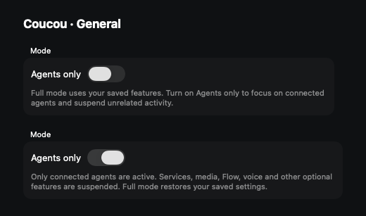

# Agents only mode on macOS

In **Settings → General → Mode**, turn on **Agents only** to focus Coucou on
connected coding agents. Turn it off to return to the full app. The switch is
available in both macOS builds and is saved across launches; full mode remains
the default. Individual feature settings, credentials and selected pills are
preserved.



The image renders the production SwiftUI control in an isolated preview. It does
not show a running agent session or change an installed Coucou app's preferences.

## Connected agents

Coucou shows agents whose hooks/plugins are installed, enabled Claude Desktop
tracking, and agents observed through `coucou_agent` events during this launch.
A catalog selection alone does not count as a connection. Unknown agent tags
(such as Pi or Oh My Pi extensions) appear when their first event arrives, without
adding a service or provider pill. When none are connected, the island explains
how to connect an agent and links to Agents settings.

Agent session tracking, tool activity, permissions, questions, terminal navigation,
agent plan usage and the local coding recap remain available. The local hook
server and configured agent transports keep running. If the iPhone link was
already enabled, agent sessions, permissions, questions and agent instructions
continue to sync.

## What stops

Agents only mode suspends the following optional work, rather than only removing
its cards:

| Feature | Suspended activity |
| --- | --- |
| n8n, Vercel, Resend, GitHub, Stripe, Cal.com, Notion | Poll timers and owned HTTP sessions; stale completions cannot publish after a stop/restart |
| Portfolio and crypto | Poll timers, subscriptions and refresh tasks |
| Music, Spotify and Mail | System observation, subscriptions, polling and owned async jobs |
| WhatsApp | Listener, polling, subscriptions, requests and the gateway process Coucou manages |
| Voice, Flow and Notetaker | Microphone pipeline, wake detection, global dictation keys and Notetaker observation |
| Machine mood | Sampling timer and system pressure observation |
| Automatic app updates | Launch check, poll timer and update session tasks |
| Desktop companion | Panel, polling and event listeners; saved position/preference are retained |
| iPhone service features | Service publication, detail/action polling and service API access; old cloud service records are removed |

Chat, file drops, window attachment, screen capture, wardrobe, unrelated settings
pages and their shortcuts are unavailable. Core island display, agent sounds,
agent settings and relevant shortcuts remain available. No mode switch installs
or removes an agent integration.

Finish an active recording, dictation, transcription, chat, capture, file copy,
model download, app update, media command or companion flight before entering the mode. The
switch stays off and explains this if such work is in progress. This avoids
losing work or leaving a recording/write partially complete. Background HTTP work
is cancelled on entry; operations already delivered to another process or remote
server cannot be undone. Returning to full mode recreates optional observation
and polling once, following the existing individual feature settings.

## Development and verification

```sh
bash scripts/test-agents-only-mode.sh
# Real application source contracts, isolated app/preferences and fake external boundaries:
bash scripts/test-agents-only-integration.sh github
bash scripts/test-agents-only-integration.sh appstore
python3 scripts/test-localization.py
# Native toggle test and screenshot (requires a macOS GUI session):
bash scripts/render-agents-only-mode.sh
cd NotchBuddy
xcodegen
xcodebuild -project NotchBuddy.xcodeproj -scheme NotchBuddy -configuration Debug \
  build CODE_SIGNING_ALLOWED=NO CODE_SIGNING_REQUIRED=NO
xcodebuild -project NotchBuddy.xcodeproj -scheme CoucouAppStore -configuration Debug \
  build CODE_SIGNING_ALLOWED=NO CODE_SIGNING_REQUIRED=NO
```

The standalone lifecycle test compiles production types under Swift 6 strict
concurrency with warnings as errors. It checks isolated preference persistence,
connected-agent filtering, empty/full visibility, 50 bidirectional mode changes,
balanced listener ownership, cancellation/resumption of optional jobs, real
URLSession cancellation using a local URLProtocol, stopped timers, rejected stale
UI delivery and rejected fallback requests after restart. It uses no model or
service credentials. The native preview also clicks the production switch in both
directions and checks its binding, without launching the installed app. The native integration executable compiles the shipping sources with a separate
entry point and unique test preferences domain. It exercises the real streaming
chat service through a fake URLProtocol (including the first visible token),
AppState switching and catalog reconciliation, normal click-to-open handlers,
CloudProbe's sync-on/ping-off path, and Mail/Crypto/Portfolio refresh cancellation
and late completions. The GitHub variant also checks the actual Flow permission
waiter, Notetaker finalization through asynchronous close/process, MacDictation's
late permission cancellation, shared prompt draft retention, and VoiceEngine's
saved-volume restoration through fake Music/Spotify Apple Event executors. The
application delegate is not launched; log writes and external boundaries are
isolated. No microphone, model, real media app or CloudKit request is used. Both
Mac targets and their DebugCloud configurations should also be built.

For manual testing with your own configured services, start in full mode, note
which optional features run, then enable Agents only while a connected agent
emits events. Check that approvals/questions still arrive, optional service
requests stop, and unrelated shortcuts cannot open their features. Switch back
and verify each enabled feature resumes once. Repeat with no connected agents
and after a relaunch. Live audio, third-party service accounts and CloudKit require
separate manual testing; the standalone tests do not exercise those services.

This implementation covers the macOS GitHub and App Store targets. The separate
Windows/Linux app and phone UI do not yet have this switch.

Recognition ownership belongs to `MacDictation`, including natural final/error
callbacks, failed startup, explicit finish and cancellation. Prompt actions hold a
short admission claim before scheduling their task; the recognizer retains its own
claim until final words reach the shared draft and cleanup completes. Generation
checks prevent old results, finish waiters and timeout callbacks from affecting a
replacement recording. Native contracts inject only the audio/recognizer boundary
and drive the shipping result/teardown handlers. The Flow keyboard regression uses
the right-Option device bit and a full-mode activation control.
