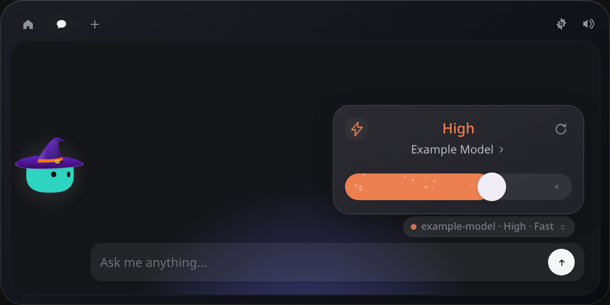
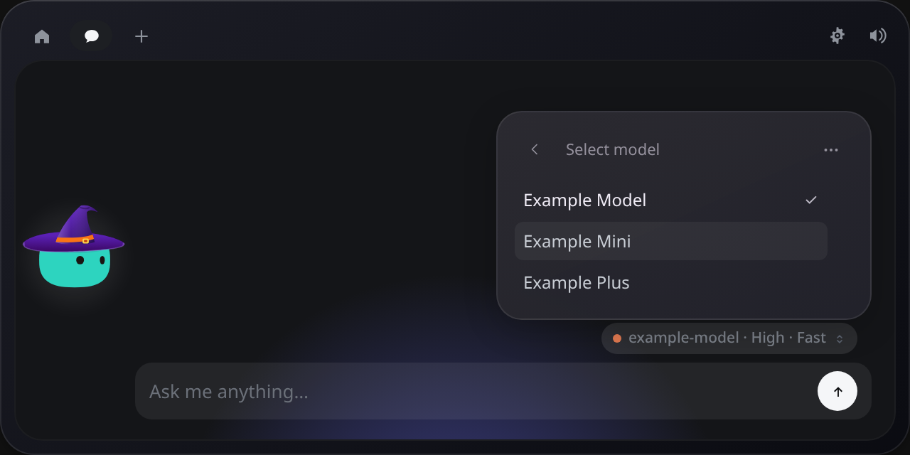
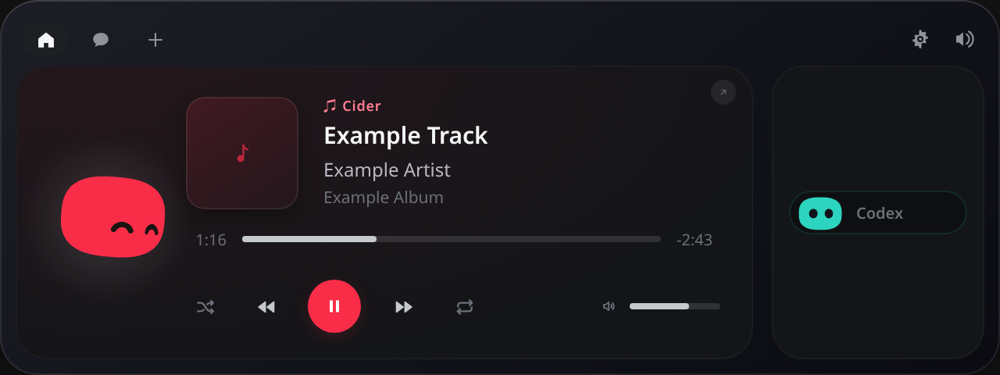

# Desktop chat, music and GNOME panel bridge

These features live in the shared Windows/Linux Tauri app (`windows/`).
The native macOS and iPhone apps are unchanged.

## Codex CLI chat

Install Codex CLI and sign in using its normal login flow. Coucou discovers the
CLI through the existing platform executable lookup and starts a private
`codex app-server --listen stdio://` process when Codex chat is first used.
Credentials stay with Codex; no API key is copied into Coucou or the webview.

In Settings → Codex CLI chat, Install/Uninstall enables or removes **only the
bundled chat integration**. Uninstall stops Coucou's app-server and hides the
provider. It preserves the CLI, login, agent hooks and model preferences.

Select Codex from the existing chat provider menu. The existing model button
opens a compact card with reasoning effort, a Fast lightning button and reset.
Click the model name to open the model list; use the ellipsis to switch providers.
Available models, effort levels and service tiers come from the authenticated
CLI catalog. Fast is enabled only when the selected model advertises it and may
consume plan usage faster. No fixed model catalog is bundled.

Responses stream into the existing conversation view. Stop interrupts the active
turn; New chat resets conversation context. Model changes retain the live thread.
A provider switch reconstructs an ephemeral thread from quoted chat history.
Threads request a read-only sandbox and never silently approve tools; interactive
approval requests are rejected. This is a chat integration, not a replacement for
an interactive terminal coding session. It is not exposed through Android chat.

## Cider music player (Linux)

Enable Cider under Active pills and run Cider with MPRIS enabled.
Coucou reads `org.mpris.MediaPlayer2.cider` on the user's D-Bus session bus, so
renaming the application's launcher does not affect discovery.

The overview shows artwork, track, artist, album, progress and playback controls
in a spacious music card, using the existing player components. Play/pause,
previous/next, seek, shuffle, repeat and volume are forwarded to Cider. The
mascot dances using its original animation engine.

No Apple Music password or account token is used. Remote artwork is restricted
to HTTPS Apple `mzstatic.com` hosts, without redirects and with a 3 MiB limit;
local artwork follows the existing Spotify file validation. Spotify remains an
independent player with its existing behavior. Other operating systems do not
start the Cider poller.

## GNOME panel bridge (Linux)

The optional companion GNOME Shell extension replaces the center clock with a
Coucou capsule. Without that extension, Coucou keeps its standalone island and
positions it below GNOME's panel. See the companion extension proposal for setup.

The app publishes bounded status and mascot frames under `$XDG_RUNTIME_DIR`.
Only counts, the focused agent's display label, phase and surface geometry are
included in status: no prompts, conversation text, working directories or keys.
The original mascot engine supplies color, outfit, gaze, dance and emotes.
Accessory bounds are measured once per outfit and smoothly fitted into the frame.

A validated live GNOME Shell PID marker enables the panel mode. The app keeps a
stable native surface while GNOME animates it from/to the clock. `closeIsland`
lets the companion dismiss it on an outside click. Picker state resets on leaving
chat so the normal height returns after closing the menu.

The frame protocol is fixed at 80×64 straight RGBA pixels, with no arbitrary
paths or image sizes accepted. The producer targets 120 frames/second when the
companion advertises `rgba120`; actual presentation follows the display clock
and available performance. Only the latest complete snapshot is retained, with
at most one IPC request in flight. Older companions use a bounded PNG fallback
at 30 frames/second. When not visible, the producer drops to one frame/second.

## Validation

From `windows/`, using Node 24 or newer:

```sh
npm ci
npx tsc --noEmit
npm test
npx vite build
cargo test --workspace --locked
```

Linux builds require the native Tauri/GTK dependencies documented in
[the README](../README.md#linux). Run tests with temporary XDG config/data directories to
avoid reading or changing real app state. Unit tests use synthetic songs, model
IDs and messages; no authenticated model requests or live music playback are
needed. Manual checks: open/close effort and model pages, dismiss the panel,
change outfits, and play/pause Cider alongside Spotify.

## Screenshots

These previews use synthetic model names and music metadata.






