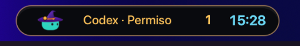

# Coucou Dynamic Island for GNOME Shell

An optional companion extension that places Coucou at the center clock position,
with a live mascot, agent status and smooth expansion/collapse of the app window.

## Requirements

- GNOME Shell 50 on Linux (Wayland or X11).
- The native Coucou desktop app on `PATH`, with the panel bridge from the companion
  desktop feature PR. Released builds without that bridge can be launched by the
  extension but cannot synchronize status, window motion or the original mascot.
- This extension is installed manually; it is not yet published on
  extensions.gnome.org. Other GNOME versions have not been validated.

## Build and install

From the repository root:

```sh
mkdir -p /tmp/coucou-extension-build
gnome-extensions pack --force --extra-source=motion.js \
  --out-dir=/tmp/coucou-extension-build gnome/coucou-island@local
gnome-extensions install --force \
  /tmp/coucou-extension-build/coucou-island@local.shell-extension.zip
```

Log out and back in after first installation or an update, then enable it:

```sh
gnome-extensions enable coucou-island@local
```

GNOME caches extension modules for the session; disabling/re-enabling is not a
reliable code update on Wayland. The normal clock is restored when disabled:

```sh
gnome-extensions disable coucou-island@local
```

To uninstall, disable it first and run
`gnome-extensions uninstall coucou-island@local`. This removes only the extension.

## Behavior

- Click or use Enter/Space to open/close Coucou, or jump to an awaiting approval.
- Right click opens the existing GNOME calendar, using its original contents.
- Click outside the app to dismiss; inside clicks keep their native coordinates.
- The app expands from the capsule and returns along the same animation path.
  Reduced motion follows GNOME's animation setting.
- The original app mascot supplies its colors, outfits, gaze, emotes and dance.
  Tall accessories are fitted by the app without changing the mascot artwork.
- Latest-frame RGBA transport avoids PNG encoding/decoding on the animation path.
  GNOME's monitor frame clock drives presentation, including 120 Hz displays.
  120 FPS is a producer target, not a guarantee on all hardware or under load.
- The clock follows GNOME's 12/24-hour preference. Disabling restores the calendar
  anchor, clock visibility, window transforms, monitors and input actors.

The extension uses GNOME Shell internal APIs to move the XWayland surface and
animate its actor, so future GNOME versions may need adjustments. Its fixed logical
window dimensions match the desktop bridge (720×320, visible width at most 640).

## Local protocol and privacy

All communication stays in the per-user `$XDG_RUNTIME_DIR`, with private files.
The extension writes a live shell PID marker and normalized pointer/visibility
state; the app validates the marker before replacing its compact window.
The app writes phase, counts, the agent's display label and visible geometry.
There are no prompts, chat text, working directories, account credentials or
network endpoints in the protocol. Nothing is uploaded by the extension.

`coucou-panel-frame.rgba` contains exactly 20,496 bytes: `CCF1`, a little-endian
u32 sequence, a little-endian f64 capture timestamp in milliseconds, then 80×64
RGBA pixels. One reusable GPU texture presents the newest complete frame.
Malformed, repeated and stale frames are ignored. A bounded 80×64 PNG fallback
supports older bridge versions. These files are mascot renders, not screenshots.

## Tests

```sh
node --test gnome/coucou-island@local/tests/*.test.mjs
```

The geometry tests cover integer/fractional scaling, a displaced window, multiple
monitors and input holes. For manual validation in a test GNOME session: change
outfits and colors, play music, move the pointer around the mascot, open/collapse
the app, click outside, open the calendar and disable the extension. Check that
input still hits visible app buttons and that the original clock is restored.
`COUCOU_PANEL_TEST=1` skips launching/controlling Coucou and writes a local UI
snapshot for a separate test session; leave it unset in ordinary use.

## Screenshots

Working status and original live mascot:


An approval waiting in the capsule:


