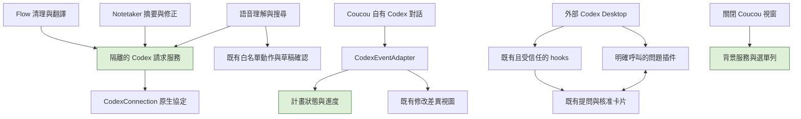

# Plan: Codex 功能補齊、桌面互動與 macOS 背景模式

## Goal

在 Coucou GitHub macOS 版，讓 Codex 可使用現有 Claude Code 整合與 Claude AI 入口提供的功能：專案聊天、使用量、提問／核准、修改差異，以及 Flow、Notetaker 和語音。關閉視窗後保留背景服務，預設不顯示 Dock 圖示；明確選擇 Quit 仍退出。已具備的能力沿用現有程式，未實作或未驗收的能力不得標成完成。

使用者已確認第 3 點為 macOS Dock。使用者已於 2026-10-27 明確同意本計畫，G1–G5 已完成程式與隔離驗證；實際帳號、鑰匙圈、語音及裝置驗收另列。Dock 修正已推送為 195d4a7。

## 實作前確認的缺口

- 已存在：Codex ChatGPT OAuth、專案聊天／附件／截圖、hooks、來源顯示、使用量、原生問答及權限核准、iPhone 問答／修改差異／Siri。
- 缺口 G1：Flow 清理、提示詞整理及翻譯仍要求 Anthropic key，介面也使用相同限制。
- 缺口 G2：Notetaker 只有 Claude／Apple／off，沒有 Codex 摘要或逐字稿修正。
- 缺口 G3：語音自然語言工具操作與網路回答仍要求 Anthropic key。
- 缺口 G4：Codex 的 plan item / turn/plan/updated 尚未顯示。不能套用 Claude ExitPlanMode 的審批格式。
- 缺口 G5：原生 turn/diff/updated 只更新手機，Mac 缺少累計差異的校正／補充。
- Dock：LSUIElement 已為 YES，但 showInDock 預設 true，啟動時覆寫為 regular。X 本身不會終止服務；明確保留關閉最後視窗仍執行的行為。

## 桌面版的正式介面邊界

- 外部 Codex Desktop 權限詢問：沿用 PermissionRequest hooks 與原 socket 的 allow／deny 回覆。
- 外部 Codex Desktop 修改重點：沿用成功 apply_patch hooks 的檔案差異。
- 外部 Codex Desktop 外掛提問：沿用明確呼叫的 $coucou-question，答案回到原本等待中的 MCP 呼叫。
- Coucou 建立的 Codex 對話：沿用原 app-server 連線處理 item/tool/requestUserInput，依 thread／turn／request 身分回覆。
- 任意外部 Desktop 內建提問：目前已核對的公開介面沒有讓第三方接管原待回答請求的通道。不得使用私有 socket、鍵盤注入、重開相同 cwd 偽裝原對話，或假稱答案已送達。未具備通道時保留回到 Codex 的操作與清楚狀態。
- 不在已安裝全域 hooks 之外再加同功能的插件 hooks，避免重複核准與重複差異。

正式依據：
- https://learn.chatgpt.com/docs/hooks
- https://learn.chatgpt.com/docs/app-server
- https://developers.openai.com/plugins/build/plugins

## Architecture / flow

## Scope

### May modify

- NotchBuddy/Sources/App/CodexConnection.swift 與新的最小隔離 Codex 請求服務、必要的服務測試。
- FlowCleanup.swift、FlowHubSettings.swift、FlowHubWords.swift：現有功能的 Codex 路由、可用性與隱私文字。
- NoteTaker.swift、FlowHubNotes.swift：Codex 引擎、摘要／修正、自動／手動入口、既有資料保護。
- ClaudeService.swift 與 Voice/ClaudeVoiceBrain.swift、VoiceDataSources.swift、VoiceEngine.swift、IslandWindowController.swift、SettingsView.swift：Codex 語音路由與一致的可用性判斷，重用既有動作。
- CodexEventAdapter.swift、AppState.swift、HookServer.swift、IslandViewContent.swift、必要的共享差異／計畫資料：計畫顯示與差異快照。
- FlowHub.swift、AppDelegate.swift：Dock 預設與關閉視窗的生命週期契約。
- Localizable.xcstrings、相關 scripts/test-*.sh／tests/、必要的使用說明。
- project.yml 及 XcodeGen 產生的專案設定，僅在新增來源需要時。

### Must not modify

- Windows／Linux／Android 執行功能與 CI／Windows PR 建置工作。
- 既有 pill ID、bundle ID、上游版本號、Keychain 格式、使用者 token／hook／Codex 設定。
- 明確 Quit 的正常退出語意。
- 與本次功能無關的版面、資料、第三方依賴或正式安裝的 Coucou.app。

## Existing patterns to follow

- 使用 CodexConnection 的 JSON RPC、大小上限、期限、取消、generation 與連線釋放；不要借用或重設專案聊天中的 thread。
- 原生 utility 呼叫不得取得 shell／檔案／未知 MCP 工具執行權。先驗證目前協定可用的工具限制設定；不能只靠 prompt 或 read-only sandbox 宣稱沒有檔案讀取能力。
- 使用者選 Codex 時不暗中改用 Anthropic。沒有可用登入／逾時時，Flow 保留原文、Notetaker 保留原逐字稿與使用者編輯，並顯示正確狀態。
- 語音沿用既有工具白名單與五輪上限；草稿寄信仍須人按 Send，權限核准仍須明確按鈕。未知工具與過期識別一律拒絕。
- 差異沿用既有 FileDiff／hunk 視圖。累計快照要更新而非重複累加，且不能改寫外部或其他 turn 的資料。

## Verification

### 三組可見流程

1. 正常：僅登入 Codex、不放 Anthropic key；Flow 清理／翻譯、筆記摘要／修正、語音白名單操作可用；自有對話與外掛提問的選項／文字能回到原請求，修改檔案與行差異可檢查。
2. 失敗：未登入、連線斷開、逾時、格式或大小錯誤時，原始文字／筆記不損壞，不啟動替代供應商，不停留在假的已連線／已回答狀態。
3. 錯誤對象：同時存在專案聊天、背景摘要、外部 Desktop 與手機；舊 thread／turn／request／fd 的答覆不得污染新卡片、觸發重複動作或倍增修改統計。

### 隔離與回歸

- 用假 app-server／socketpair fixtures 驗證實際服務、權限、期限、取消、工具白名單與並行，不在測試中登入或呼叫真實模型。
- 累計 diff 事件重送／校正與 item + aggregate 混用時，檔案與統計不重複；plan 狀態忽略錯誤對象。
- Dock fixture 不讀寫真實偏好或操作 NSApp；驗證預設 off、明確 on／off 保存、關閉最後視窗不退出。
- 執行相關既有 Codex／Flow／Note／Voice／Phone 測試、完整繁中檢查、Mac GitHub Release + App Store Debug + iPhone Debug 建置。
- 實際 UI 驗收：沒有 Dock 圖示；X 後 hooks／問答仍工作；選單列可重開；明確 Quit 才退出。Desktop 外掛安裝與 hook 信任需使用者在介面確認，不能用 fixtures 代稱已驗收。

## Done definition

- [x] G1–G5 有實作、對應驗證與明確限制；既有能力逐項回歸（假服務／隔離測試，非實機驗收）。
- [x] Dock 預設背景模式與關閉最後視窗行為通過隔離測試及兩個 Mac 目標建置；真人 UI 驗收尚未執行。
- [x] 不宣稱可攔截或回答任意外部 Desktop 內建提問。
- [x] 所有新介面文字有英文與繁中，既有語系與資料完整保留。
- [x] PR 說明稿披露 AI 修改、人工未逐行審查、fixtures／建置／實機驗收之區別。

## Risks & rollback

本次含 Core Code：額外模型請求、背景並行、語音動作及問答身分。需模組擁有者與第二位 reviewer 檢查。新能力應以可獨立回復的提交實作；回復相關提交或改回既有供應商，保留既有登入與筆記資料。

## 實作決策與驗收邊界

- 已確認：接受上述正式桌面通道邊界，並依本計畫補齊其他缺口。
- 文字 utility 以 Codex CLI 0.163.0 的明確設定禁用本機工具、MCP、hooks、plugins、skills 與 agents。已用真實 CLI 搭配本機假模型驗證工具列表；未呼叫真實模型。不能只靠 dynamicTools: [] 或 read-only 宣稱工具已禁用。
- 背景功能預設停用，設定頁分開顯示帳號連結與背景啟用狀態。明確啟用只執行帳號檢查，可由使用者完成一次鑰匙圈授權；不得自動操作系統授權視窗。
- 每次文字請求獨立 process／thread／工作目錄，專用 HOME 固定以保留鑰匙圈授權。專用項目只含 access／id／account，不含原生 refresh token 或 API key；閒置與退出嘗試清空 access 資料，停用時嘗試刪除確切擁有的項目；鑰匙圈鎖定或不可用時可能延後清理，不變更原生憑證。
- 計畫與差異依 thread／turn 身分更新，累計快照校正淨差異，保留既有有上限的歷史；外部工作階段不會被改寫。
- 真實 ChatGPT 模型、已簽署版本的一次鑰匙圈授權、麥克風／聯絡人／音樂、Desktop 插件信任、iPhone 雲端路徑與 Dock 真人操作仍待使用者驗收。
